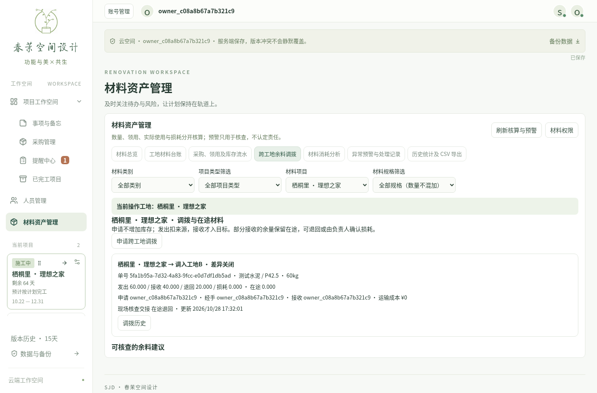
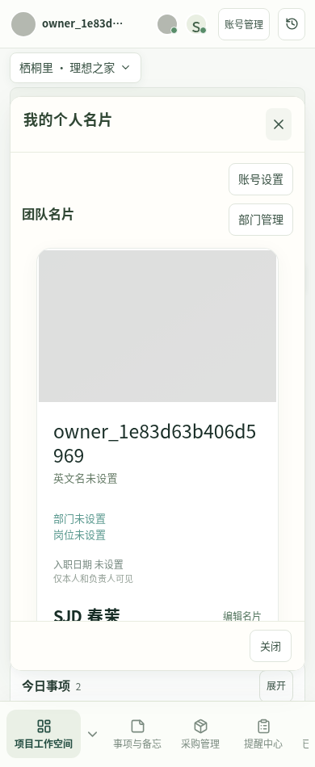

# 使用体验与业务管理 V1.1：全模块实现与验收

更新：2026-10-28。当前功能分支 `feat/chunmo-project-manager`，基于 `33a484dc24e521d13f9caf613b93cd86708adbe1` 增量实现六个模块。以下描述实际代码和本轮验证，不将需求文档或表结构本身视为业务交付。**未连接ECS、执行生产迁移、部署或重启线上服务；生产验收待负责人确认。**

## 开发前版本核对

工作区开始时干净；本地HEAD、远程跟踪引用和实际 `git ls-remote` 均为上述33a完整提交。重新核对代码，确认原采购保留完成记录、材料账本、授权、名片及首页视觉基础存在，未重建项目。

工作区现存旧包 `chunmo-dde8e2f-full.bundle` 的内部功能分支实际为 `dde8e2f51b6b86b41ff9b70c28ed5fbb3fdbee91`，不能用于交付33a首页或本轮功能。未找到用户此前验证为fdb3a0a的那份同名包，无法确认其生成或上传环节的原因。新打包工具以真实Git引用、全历史新克隆及文件树核验，不能以文件名判断版本。

内部按采购→材料→甘特→四卡→在线头像→名片实施，全部完成后统一回归；不再采用此前“只做首页或第一阶段”的暂停边界。旧分阶段文档是本轮开始前计划。

## 六模块实际实现

| 模块     | 实际能力                                                                                                                                                     | 主要代码                                                                                                                                                                       |
| -------- | ------------------------------------------------------------------------------------------------------------------------------------------------------------ | ------------------------------------------------------------------------------------------------------------------------------------------------------------------------------ |
| 采购     | 提醒独立删除及确认；全部/待采购/已完成筛选；完成只改状态；负责人恢复；可信创建/修改/完成身份和时间；追加历史；删除后保留追溯和材料引用                       | `server/purchase-tracking.ts`、`server/purchases.ts`、`server/store.ts`、`src/components/PurchaseCard.tsx`、`src/App.tsx`                                                      |
| 材料     | 先选工地，未选时业务区不可操作；切换重置未提交表单；统一数量/成本流水；多阶段调拨、部分接收、退回、损耗及历史；同规格/工艺/真实基数比较、高低用量和盘点预警  | `server/transfers.ts`、`server/materials.ts`、`src/lib/materials.ts`、`src/lib/transfers.ts`、`src/lib/material-recommendations.ts`、`MaterialsPanel.tsx`、`TransferPanel.tsx` |
| 甘特     | 左右边缘持续自动滚动；距离、停留及指针速度影响滚速；中央停止；拖动中的虚拟任务保持挂载；保留日期/合并/提前顺延；取消任务独立逾期提示，保留采购及项目剩余工期 | `Gantt.tsx`、`src/lib/gantt-scroll.ts`、`src/lib/model.ts`、`App.tsx`                                                                                                          |
| 四卡     | 共用组件；默认最多3条；一致的就地展开/收起、内部滚动、轻动效；操作和编辑保留，收起重置卡内滚动                                                               | `BriefPanel.tsx`、`App.tsx`、`src/v11.css`                                                                                                                                     |
| 在线头像 | 固定尺寸、8px间距、不重叠；保留真实在线成员；多人数有上限与“+人数”、可横向滚动；主操作不被挤出                                                               | `CollaborationBar.tsx`、`src/v11.css`                                                                                                                                          |
| 名片     | 顶部本人头像打开浮窗；复用原名片/部门/账号管理；新增岗位；独立名片头像与系统头像分别上传/清除/读取；名片右上方打开现有账号设置                               | `PersonalCard.tsx`、`MemberCards.tsx`、`Avatar.tsx`、`AvatarEditor.tsx`、`CloudControl.tsx`、`server/member-cards.ts`、`server/auth.ts`、`server/app.ts`                       |

普通员工可维护原授权个人资料及本人两个头像；部门/岗位仅负责人维护。手机号、生日、私密入职日期和账号管理继续使用原服务端独立权限，未因新浮窗放宽。

### 采购身份、删除与恢复

- `Purchase` 主记录及原API保存方式复用；客户端不能提交可信操作人、完成时间或历史字段，严格模型拒绝伪造字段。工作空间行锁与revision冲突检查仍生效。
- 服务端在同一事务生成 `purchase_record` 元数据及 `purchase_action`；时间来自服务器，展示按 `Asia/Shanghai`。首次导入的旧记录没有可信创建/完成信息时显示未知，不用导入者冒充原创建人。
- 已完成包括兼容的历史“已到货”。员工直接提交恢复待采购请求会403；删除后再用原ID重建也不能绕过。负责人恢复只更新当前状态，之前完成事件和时间保留；15天历史恢复不把恢复时间伪造为原完成时间。
- 删除从正常采购集合移除，独立追溯仍保留；材料流水不级联删除。历史入口可查看创建、完成、恢复、删除等操作。完成提醒不产生订单、入场或库存流水。

### 调拨与核算规则

1. **申请→待发出**：记录工地、材料、数量、申请账号、经手账号、运输成本和原因，不增加目标可用库存。
2. **发出→交接中**：一次事务从来源现场库存移到独立在途保管数量/成本；目标库存仍为0。来源不足、台账关闭或并发冲突时整体失败。
3. **部分/全部接收**：只将本次确认数量从在途移到目标；记录实际接收账号及时间。剩余继续在途，不能被两个工地重复使用。
4. **取消/差异处理**：未发出可直接取消；已发出不能直接取消，须登记在途退回。全部退回标记已取消；部分接收后退回/核实损耗，余量归零后为差异关闭。只有负责人可确认在途损耗，原因必填。完成接收后的退货应另建反向调拨，不能删除或直接冲销交接流水。
5. 同一工作空间写锁、版本号、请求ID/内容摘要及数据库唯一约束共同防重复；重试同一请求返回原结果，改变内容或过期版本明确拒绝。所有步骤和库存流水同事务提交，异常回滚。
6. 在途损耗单独展示数量和成本；发出已计入调出，不能再扣一次现场库存或冒充施工使用。单位换算、BigInt精确核算、盘点及旧即时调拨记录继续保留；新请求必须走调拨单，不能绕过流程直接给目标入库。
7. 未结束调拨阻止相关材料清仓。项目15天恢复不抹除独立调拨、在途及原始材料事件；关联工地被移除时操作明确失败并要求恢复关联，不自动换工地。

建议复用同一计算函数：来源现场余量扣除后续需求预留，目标扣除已持有及在途数量；相同工地/规格去重，按进场计划分配建议上限，不在多个建议中重复占用余料。运输估算可登记，未知明确显示需核实；质量、可复用性、搬运和变更仍需授权人现场核验。建议不会创建调拨或改库存。

用量比较增加可选的经核实施工人数和天数，未知不虚构。实际基数仍区分施工面积、长度、面积×遍数。历史至少5个独立同类项目才计算参考区间；完成核算后低于下限、超预算/高于上限及盘点差异均可提示核查。统计不是责任认定或校准概率。

### 四卡与提醒规则

取消施工任务逾期后，首页保留5项统计，原 `overdueTasks` 返回形状兼容但为0；采购逾期、材料核查、项目计划与剩余天数保留。任务本身、状态、日期和持续天数不因此删除或改写。

四卡都可通过明确的展开/收起按钮操作，不依赖悬停。默认最多3条，更多数量有提示；展开使用卡内滚动，编辑或处理后仍在原首页。保留“查看全部”作为可选择的跨模块入口，不强制跳转。

## 009增量迁移与兼容

`server/migrations/009_experience_v11.sql` 仅新增：

- `purchase_record`：当前采购追溯投影及删除标记。
- `purchase_action`：不可变采购操作历史。
- `material_transfer`：调拨单、版本和交接状态。
- `transfer_submission`：不可变调拨幂等结果。
- `card_avatar`：本人独立名片PNG、版本及时间。
- `member_card.job_title`：旧数据默认空岗位，不改账号ID、角色、密码、部门或入职日期。

人数/天数、运输估算作为现有材料JSON的可选字段兼容，未改已应用001–008迁移、清空数据或重新建库。部署迁移白名单与最小权限同步增量更新；历史表不能UPDATE/DELETE，追溯/调拨主记录无DELETE权限。测试库001–009校验和实际核对一致。

完整备份沿用既有加密数据库备份。项目JSON和15天项目快照**不包含**独立采购操作历史、调拨、材料、名片头像及账号资料，不能代替全库备份。Bundle只含Git代码，也不包含数据库和密钥。

数据库增量保持旧SQL插入兼容，但发生新调拨流水后，旧版材料计算器不认识新事件类型：不得仅换回旧代码就声称业务可兼容。需使用支持009的修复版本；如确需数据库灾难恢复，先在隔离库验证并由负责人另行批准，不自动回滚或覆盖数据库。原HTTPS15001、CA、Nginx/后端/PostgreSQL监听、备份计划及部署配置未修改。

新增采购追溯特意与HTTP路由分离，避免原生部署引导在尚未生成API运行配置/密钥时提前加载数据库连接；增加无运行环境导入的回归测试。

## 实际验证

| 检查               | 结果及范围                                                                                                                                          |
| ------------------ | --------------------------------------------------------------------------------------------------------------------------------------------------- |
| 单元测试           | 93/93；新增在途数量/成本、关闭目标、低耗、来源需求与建议去重、边缘速度等规则                                                                        |
| PostgreSQL/API     | 42/42；真实角色/CSRF、采购身份/完成/恢复/删除、历史恢复、调拨并发/幂等/部分接收/退回/损耗、双头像及增量升级                                         |
| 本地浏览器全量     | 83/83；原工期/项目/采购/PNG/持久化/手机触摸及新增四卡、删除与边缘拖动                                                                               |
| 左右边缘及四卡再验 | 3/3；持续停留向右和向左滚动、中央停止、刷新后日期一致                                                                                               |
| 云端浏览器全量     | 26/26；真实账号、双会话、SSE、权限、完整材料界面与新增流程                                                                                          |
| 最终云端交互复验   | 4/4；1440/390px采购历史、调拨、头像排列、独立头像、刷新/重登与账号设置                                                                              |
| 生产构建           | 前后端TypeScript、Vite、esbuild通过；原有Zod注释及主JS大于500kB的非阻断提示仍存在                                                                   |
| 部署工具构建及回归 | 22/22；包含新增引导测试及原HTTPS证书、备份前置与回滚测试，没有执行部署                                                                              |
| 备份/恢复          | 多次009正样本加密备份、新隔离库恢复通过；逐项核对新表、部分调拨、幂等、独立图片、岗位/私密日期、精确数量/成本和不可变历史；源库、恢复库、原备份保留 |
| 格式、差异和离线包 | 定向Prettier、`git diff --check`；打包后核对完整SHA、单一功能分支、新克隆文件树和Git完整性                                                          |

已定位并修复/复验的失败：旧测试仍要求施工逾期/共享头像；同一合成测试IP触发真实限流（隔离测试来源，未放宽生产限流）；展开按钮改名后的定位失效；读取异步删除历史过早；可选运输估算被误设必填；部署引导间接依赖API运行配置。没有删除权限或业务断言来掩盖失败。

本机最初调用不存在的`pg_dump`产生的空文件不算有效备份；最终使用现有隔离PG17容器内工具，认证加密备份和新库恢复均实际成功，不将该空文件或生产备份计为通过。

可复现的恢复验证脚本：`node --env-file=.env.test.local --import tsx scripts/test-v11-restore.ts`。仅接受本机`chunmo_test`集群配置，创建新的隔离库和最小权限角色，不恢复覆盖原库；需要可执行的PG17客户端，可通过`CHUNMO_TEST_PG_DUMP`、`CHUNMO_TEST_PG_RESTORE`指定测试客户端路径。

## 验收步骤

1. 负责人、员工分别登录。新建采购→完成→采购管理选已完成→看责任时间和历史；员工恢复请求被拒，负责人恢复后原完成事件仍可查。删除前取消不丢记录，确认后提醒消失、历史和相关材料流水保留。
2. 材料管理先不选工地，检查不能录入；选A，登记入场100。申请A→B 60并批准，B仍不增加；发出后A40/B0；接收40后B40、在途20；退回20后A60/B40、差异关闭。另测未发出取消、重复点击、超量、并发与负责人损耗确认。
3. 核对项目面积/工艺/实际基数、人数/天数与运输估算。足够同类项目显示参考及高低差异，样本不足只提示；核查历史可追溯，无自动处罚或调拨。
4. 甘特分别向左右边缘持续拖动，离开边缘到中间应停止；松开仅出现原有一次调整决策。保存刷新核对起止日期、合并段及其他项目。采购逾期仍显示，施工独立逾期不再显示。
5. 四卡各准备4条以上内容：默认3条，展开原地显示、内部滚动、末项可编辑/完成，再次收起。手机触控不依赖悬停；空状态紧凑。
6. 两账号在线看固定间距；人数增加检查“+人数”和横向滚动不挤压账号按钮。点本人头像，编辑名片、独立更换名片头像；通过右上方账号设置改系统头像，两者互不覆盖，刷新和重新登录均保留。

## 页面证据与限制

截图均为隔离测试账号和合成资料，灰色图片是测试PNG，不是真实人员照片：





实体Windows/iPhone/Android、真实工地数据和ECS部署仍待负责人验收。当前头像沿用经校验的256px裁切方案，不是高清原始照片库。质量与运输成本依赖人工核实；统计样本不足不承诺预测概率。

## 新离线包生成与版本核验

在已提交的当前功能分支执行（输出目录必须在源码仓库外，且不可已存在）：

```powershell
node scripts/create-offline-bundle.mjs ..\deliveries\chunmo-v11-verified
```

工具会拒绝脏工作区/错误分支，生成包含功能分支及完整Git祖先历史的Bundle；核验内部引用完全等于源HEAD、新裸克隆的HEAD、`git fsck --full --strict`及009/首页/新模块文件；最后才发布正式Bundle、`manifest.json`与`SHA256SUMS`。目录存在则停止，避免覆盖或重复使用同名旧包。

Workbench将来收到包后，**先核对SHA256和manifest完整targetCommit**，再执行：

```bash
sha256sum -c SHA256SUMS
git -C /opt/chunmo-source bundle verify /实际上传目录/manifest中指定的文件.bundle
git -C /opt/chunmo-source bundle list-heads /实际上传目录/manifest中指定的文件.bundle refs/heads/feat/chunmo-project-manager
```

输出引用必须逐字等于manifest目标SHA；不是看文件名包含哪个短SHA。以上仅验证代码包，不执行fetch、合并、迁移或部署。负责人验收后再安排现有离线导入及备份部署流程；`update.sh`自身会联网fetch，不能将其误称为完全离线命令。

## 本轮实际修改文件

```text
PROJECT_GUIDE.md
cloud-tests/account-grants.spec.ts
cloud-tests/experience-v11.spec.ts
cloud-tests/materials.spec.ts
deploy/native/admin.ts
deploy/native/approved-migrations.json
deploy/native/bootstrap.test.ts
docs/experience-v11-stages.md
docs/experience-v11-validation.md
docs/screenshots/experience-v11/personal-card-390.png
docs/screenshots/experience-v11/transfer-1440.png
scripts/cloud-provision.ts
scripts/create-offline-bundle.mjs
scripts/test-v11-restore.ts
server/app.ts
server/auth.ts
server/cloud.test.ts
server/materials.ts
server/member-cards.ts
server/migration.test.ts
server/migrations/009_experience_v11.sql
server/purchase-tracking.ts
server/purchases.ts
server/store.ts
server/transfers.ts
src/App.tsx
src/components/Avatar.tsx
src/components/AvatarEditor.tsx
src/components/BriefPanel.tsx
src/components/CloudControl.tsx
src/components/CollaborationBar.tsx
src/components/Gantt.tsx
src/components/MaterialsPanel.tsx
src/components/MemberCards.tsx
src/components/PersonalCard.tsx
src/components/PurchaseCard.tsx
src/components/TransferPanel.tsx
src/lib/cloud.ts
src/lib/gantt-scroll.test.ts
src/lib/gantt-scroll.ts
src/lib/material-recommendations.ts
src/lib/materials.test.ts
src/lib/materials.ts
src/lib/member-cards.ts
src/lib/model.test.ts
src/lib/model.ts
src/lib/transfers.ts
src/main.tsx
src/v11.css
tests/homepage.spec.ts
tests/v11-workflows.spec.ts
tsconfig.server.json
```
