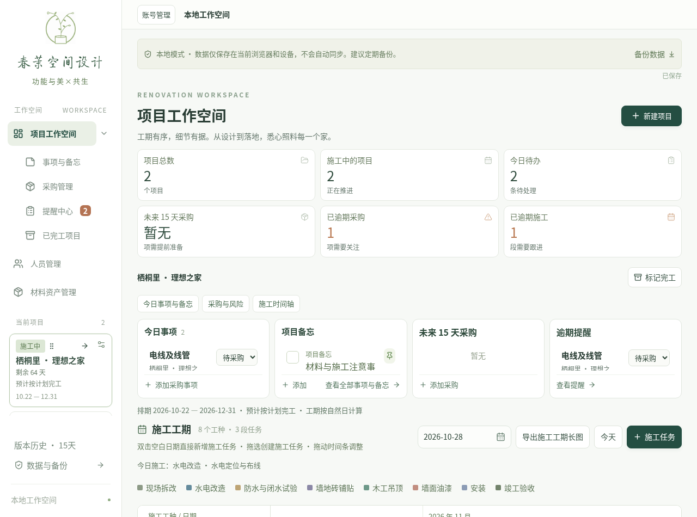
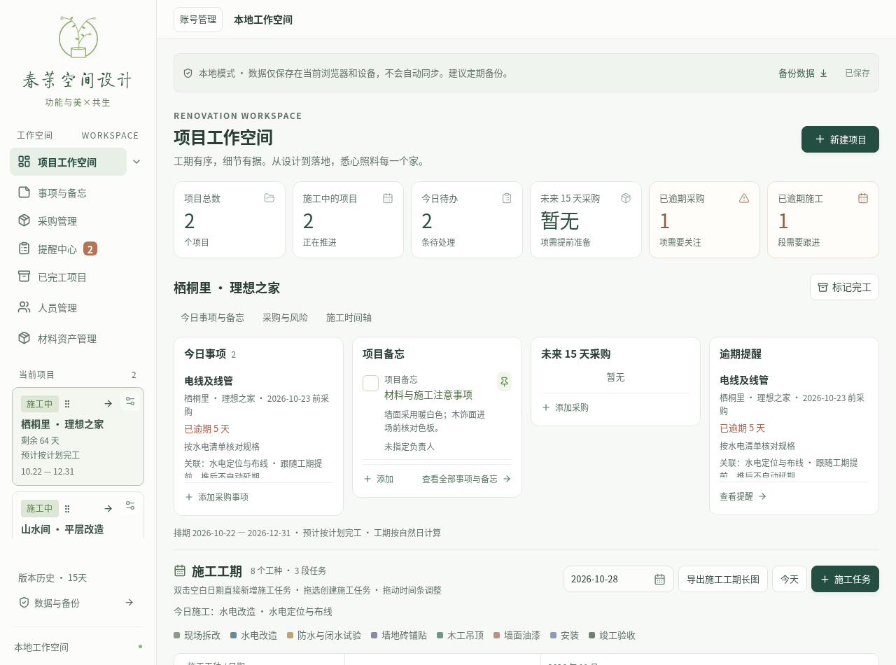
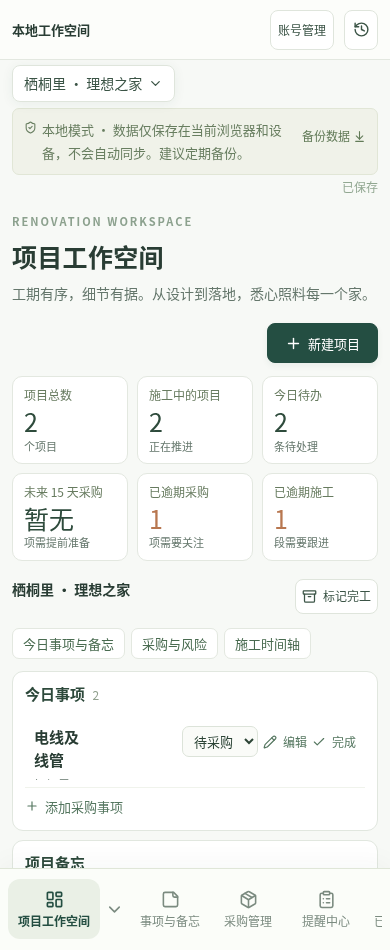
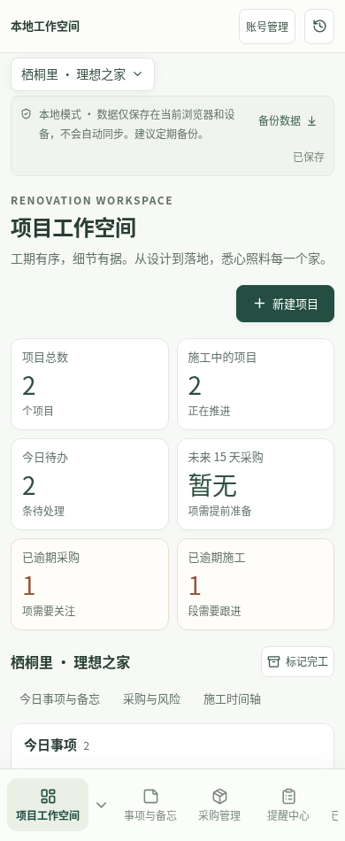

# 项目工作空间首页 UI/UX 验收（2026-10-28）

本轮仅优化首页视觉。基于 `feat/chunmo-project-manager` 的 `fdb3a0a` 增量修改，未连接 ECS、修改 main、部署生产、执行数据库迁移或清理 IndexedDB。首页已完成代码和自动化验证，**仍待负责人实际视觉验收**。新 V1.1 业务任务按[分阶段计划](experience-v11-stages.md)安排，尚未启动。

## 实际审查及设计依据

首页由 `src/App.tsx` 组合现有统计、采购/备忘卡片、甘特图和弹窗；原样式来自 `src/style.css` 和其后加载的 `src/compact.css`。原四卡桌面固定146px、手机160px，采购标题与一组操作争抢横向空间；1280px窗口统计排成两行，手机三列信息较挤；状态区层级偏重，导航子菜单图标缩进不一致。

实际尝试访问 `https://www.apple.com.cn/` 和 `https://www.nio.cn/`，均被当前环境代理返回 `403 Forbidden`（CONNECT失败），没有读取到网站页面或动态内容。没有声称完成官网实页分析，也没有复制其图片、Logo或代码。依据用户提供的参考方向提炼：清晰的字号层级、安静的状态提示、统一控件基线、温和绿色与白色表面、少量圆角和轻阴影；管理系统以读信息和操作效率为先。

## 实际修改

| 文件                                   | 改动及边界                                                                                                                           |
| -------------------------------------- | ------------------------------------------------------------------------------------------------------------------------------------ |
| `src/App.tsx`                          | 仅首页增加 `.homepage` 作用域，将原保存/备份提示放入同组容器；内容、事件处理及条件判断保持原样，其他模块容器使用 `display: contents` |
| `src/main.tsx`                         | 在原样式之后引入首页专用CSS                                                                                                          |
| `src/homepage.css`                     | 所有选择器限定 `.homepage`；不改全局共享样式、账号弹窗或其他模块                                                                     |
| `tests/homepage.spec.ts`               | 7项浏览器测试，覆盖4种窗口宽度、可读性、真实操作入口、长列表、甘特几何和跨模块样式隔离                                               |
| 本文与 `docs/screenshots/homepage-v1/` | 使用合成项目的改版前后实页截图及验证记录                                                                                             |

- 保留原春茉Logo、品牌字体及绿色体系，规范首页标题24px、正文14px、常用辅助信息至少12px。英文辅助标题、空状态及导航小字加深到可读的灰绿，白底对比度约5.1:1。
- 桌面导航图标、文字、箭头按相同网格对齐；保留原菜单、项目选择、排序、设置、工期及日期信息。
- 云端/本地说明、备份、保存状态及撤销组成紧凑状态区；原失败提示、版本冲突处理和同步逻辑不变。
- 六项统计保留真实计算和风险条件：宽屏6列、1024px为3列、390px为2列，统一数字基线及说明位置；无事项继续显示“暂无”。
- 四卡采用内容决定高度，空卡桌面128px、手机146px；有内容时增长、长列表内部滚动。标题对齐，混合内容的卡片不强制等高。采购标题占满一行，操作另起一行保留；未删除编辑、完成、状态、查看及新增入口。
- 甘特标题/任务数、图例、日期工具栏统一层级和基线；日期列仍是56px，左侧固定栏及原JS行高、任务颜色、日期、拖动、调整、合并、导出逻辑均未修改。日期/星期仍可读，控件按完整单元换行。
- 仅调整首页直接打开的业务弹窗间距、圆角及阴影，沿用原关闭、确认、取消和权限处理；手机保留较大的触摸控件，不采用全局缩放。

本轮没有实现新任务书要求的“四卡统一就地展开/收起”，当前是已有操作加内容滚动；该交互属于后续阶段4，不能算作已完成。

## 改版前后

同一组**合成数据**、同一日期及浏览器窗口进行截图，不使用真实项目或个人信息。前图来自改版前源码，后图来自本轮最终首页样式。以下截图是代码库内文件，可直接在GitHub查看。

1280 × 950 桌面，改版前：



1280 × 950 桌面，改版后：



390 × 950 手机窗口，改版前：



390 × 950 手机窗口，改版后：



| 实测对比                          | 改版前    | 改版后                   |
| --------------------------------- | --------- | ------------------------ |
| 1280px统计卡片列数                | 3列、2行  | 6列、1行                 |
| 390px统计卡片列数                 | 3列       | 2列，提高每张卡可用宽度  |
| 1280px甘特可视宽度（clientWidth） | 998px     | 1006px                   |
| 1024px甘特可视宽度（clientWidth） | 742px     | 750px                    |
| 四卡桌面空状态高度（含边框）      | 固定146px | 128px                    |
| 1440/1280/1024/390px页面横向溢出  | 无        | 无；甘特保留独立横向滚动 |

截图只显示首屏；完整甘特操作和采购滚动内容在浏览器测试中另行验证。手机六卡由三列改为两列会增加该组总高度，这是可读性取舍，不声称手机整页机械缩小。

## 本轮实际测试

| 检查                                                                                                                             | 结果                                                                                                                            |
| -------------------------------------------------------------------------------------------------------------------------------- | ------------------------------------------------------------------------------------------------------------------------------- |
| `npm test`                                                                                                                       | 14个文件，88/88通过                                                                                                             |
| `npm run test:e2e -- --output=/tmp/chunmo-home-regression`                                                                       | 80/80通过，包含新增7项首页测试及原工期拖动/排序/多段合并/提前顺延/采购/持久化/PNG/手机触摸回归                                  |
| `npm run test:cloud:e2e -- cloud-tests/collaboration.spec.ts cloud-tests/account-grants.spec.ts --output=/tmp/chunmo-home-cloud` | 6/6通过；隔离本地PostgreSQL测试库、真实负责人/员工账号及双浏览器会话，验证登录、服务端权限、SSE、冲突、采购延期审批、密码与退出 |
| 最终首页样式定向复验                                                                                                             | 调整辅助文字对比度后7/7通过                                                                                                     |
| `npm run build`                                                                                                                  | 前端TypeScript/Vite及后端TypeScript/esbuild生产构建通过                                                                         |
| Prettier定向检查、`git diff --check`                                                                                             | 通过                                                                                                                            |

首页测试在1440、1280、1024、390px检查统计基线/高度/列数、空状态高度、字号、工具栏不重叠、弹窗适配、滚动保留、日期格与任务格56px对齐及左栏固定；验证采购编辑/完成等入口、8条采购长列表末项可访问、关闭编辑不改业务数据。切换事项、人员和材料页面后，禁用/启用新增首页样式的实测尺寸与样式相同。

测试全部使用隔离浏览器与合成数据；未清理用户浏览器、生产数据库或现有备份。本轮没有执行ECS部署验收，也没有将此前API全量或部署测试结果算作本轮执行。构建仍有已有非阻断提示：Zod注释注解和主JS大于500kB，未为消除提示重写架构或增加依赖。

## 本地预览与人工验收

Windows在已有源码目录同步当前功能分支后，可使用测试预览模式检查视觉，不需要导入、覆盖或清空原有本地数据：

```powershell
git switch feat/chunmo-project-manager
git pull --ff-only origin feat/chunmo-project-manager
npm.cmd ci
$env:VITE_ALLOW_LOCAL = "true"
npm.cmd run dev -- --host 127.0.0.1 --port 5173 --strictPort
```

在新的浏览器配置或隐私窗口打开 `http://127.0.0.1:5173`，选择原有本地预览入口；不使用原业务浏览器上下文做测试。该开发选项仅用于本机UI验收，不用于生产构建或绕过云端API认证。云端账号/SSE回归由上表独立测试后端验证。

请重点人工查看：Windows Chrome/Edge 100%及125%缩放、真实手机Safari/Chrome的字体和触摸体验；检查长项目名、采购长备注、四卡内部滚动及甘特横向操作是否符合日常习惯。本轮自动化是Linux Chromium桌面/手机尺寸及既有触摸测试，不等同实体Windows、iPhone或Android设备验收。

首页视觉验收后，下一阶段先做**采购记录与状态管理**，不同时启动材料调拨或数据库改造，见[V1.1分阶段计划](experience-v11-stages.md)。
