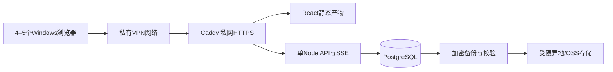

# 阶段 B 架构设计（设计稿，未部署）

2026-10-24。已知用户购买：阿里云北京、Alibaba Cloud Linux 3、2 vCPU/2 GiB RAM、40 GiB盘、4 GiB Swap。**没有登录服务器核验实际使用率，没有安装任何软件，没有建立云库、迁移或部署**。本文件不是可直接执行的生产配置。

## 低资源推荐

保留 React/TypeScript/Vite 前端，构建静态产物；新增一个 Node.js LTS + TypeScript API 进程，共享经过审查的 Zod/日期/工期纯函数。PostgreSQL作为唯一多人业务权威数据源。Caddy承接私网HTTPS、静态文件和同源 `/api`、SSE。不把 Vite 当生产服务器。不引入Redis、消息队列、Kubernetes、独立搜索或CRDT。

先评估同机PostgreSQL：该规模轻量结构化数据可作为测试候选，不保证实际负载达标。建议起始预算：Node堆上限384 MiB，PostgreSQL shared_buffers 64 MiB、work_mem 2 MiB、max_connections 20、API连接池4，Caddy约64 MiB预算；VPN和系统预留300–450 MiB，总工作集目标1.2–1.5 GiB以内，留余量。连接数并不等于用户数。将实际RSS、响应延迟、OOM、Swap换入换出和磁盘I/O纳入验收后调整，**4 GiB Swap不是新增内存**。

镜像在CI/开发机构建，ECS只拉取固定提交摘要产物，不在2GiB服务器同时跑npm构建和备份。单API实例优先，数据库只监听loopback/内部网络，不开公网5432。先不购买更昂贵机器；若频繁换页、长图服务端生成、照片/历史体积或备份争用出现，再评估托管PostgreSQL或扩容。图片长图继续浏览器生成，避免服务器画布内存峰值。

40GiB盘需先核对系统、镜像、WAL、数据库与Swap文件的实际占用。设置容量报警和备份上限，不无限保留镜像/日志/本地数据库副本；不自动删除业务数据腾空间。

## 无购买域名的私网访问

推荐先试Tailscale独立工作室tailnet，ECS和Windows设备入网。ACL只允许已批准的成员设备访问应用443，SSH仅运维身份；数据库不发布tailnet端口。不启用Funnel或公网应用入口。VPN身份是网络边界，**不能替代应用账号认证和逐请求权限**。

可使用提供的 `主机名.tailnet名称.ts.net` 和MagicDNS，不需另购域名；验证支持的HTTPS证书方案（Tailscale证书或受信内部CA）。不得为了无域名改用公网HTTP或关闭TLS验证。内部CA方案需要在批准的Windows设备安装信任根；仅安装到客户端不是云端服务已经上线。

北京到控制平面、DERP、中继及Windows端的实际连通性/延迟须在独立测试环境验证。若不可用，备选WireGuard/阿里云私网接入方案，明确密钥分发和吊销；安全组仅允许必要VPN端口，管理入口限制来源，不开放所有公网管理端口。不假定服务器当前已具备VPN。任何正式部署仍需用户确认目标环境及访问配置。

## 账号、会话与授权矩阵

单工作室也使用organization边界。账号由负责人邀请创建，可停用、重置密码并撤销会话；没有公开默认账号/密码。账号使用Argon2id（初始评估64MiB内存成本，限制并发哈希与登录频率），随机服务端会话令牌哈希存库。Cookie为Secure/HttpOnly/SameSite，轮换登录会话、空闲/绝对过期、退出和账号停用后立即撤销。变更请求校验Origin、CSRF和会话；私网仍然同样要求。

| 范围                 | 负责人               | 被分配项目经理/授权管理员            | 设计人员         | 施工协作者                     |
| -------------------- | -------------------- | ------------------------------------ | ---------------- | ------------------------------ |
| 项目资料/工期/采购   | 全部                 | 本项目按授权写                       | 本项目按授权读写 | 仅必要施工安排；默认不可改工期 |
| 人员公开档案/分配    | 管理                 | 按项目职责                           | 必要姓名/工种    | 自己必要安排                   |
| 内部星级评价/明细    | 可读写               | 需独立reviews.read/write授权且限项目 | 默认无           | 无                             |
| 完整手机号           | **唯一工作室负责人** | 无（含普通管理员）                   | 无               | 无                             |
| 出生日期             | 独立字段授权         | 默认无                               | 无               | 无                             |
| 邀请/角色/负责人转移 | 高权限独立流程       | 无默认提升权限                       | 无               | 无                             |
| 备份、导入、历史恢复 | 单独权限并二次确认   | 明确范围授权                         | 默认无           | 无                             |

负责人身份来自数据库唯一 organization.owner_account_id，不能用客户端role、人员类别或项目经理字段认定。所有API含列表、搜索、导出、恢复、SSE、历史、日志都过组织/项目/字段授权。普通SQL访问角色不能读取私密表；私密查询独立仓储层，响应不得先发原值再打码。数据库RLS可作纵深防御，连接池事务内SET LOCAL授权上下文，不能把RLS当成唯一校验。

## 关系型模型与历史

保留现有业务稳定ID，现有ID是opaque字符串，数据库使用TEXT主键/组合外键而不是强制重建为UUID；新ID可继续用UUID字符串。

- organization、account、membership、session、project_membership、user_preferences(user_id, organization_id, navigation_expanded)。偏好按真实会话user_id读取/写入，不信任请求体身份。
- project(organization_id,id,revision,start,end,status,...)；trade/project_order；task及task_dependencies、group_id；note；purchase及purchase_deadline_change。所有子记录用复合外键确保同组织同项目，状态保留稳定逻辑值。
- person与独立dictionary；person_category、person_trade；assignment(project/trade/task范围、person_id)。项目团队不能推断为全程在场；工种分配的任务段由统一查询派生，任务级例外需要明确规则，不能两页各存姓名或日期。
- personnel_private：手机号加密及生日，独立授权、独立备份和密钥；普通person DTO不含私密列。
- personnel_review(id,organization_id,person_id,project_id,reviewer_account_id,review_date,score CHECK 1..5,notes,created_at,supersedes_id)。评价追加记录，修订保留原版本与原因，不原地覆盖历史；评分采用获授权、未撤销有效记录的平均值，零条显示暂无评价。reviewer由会话确定，不能让前端冒充。评分及评语不进入普通人员卡片响应、项目快照、公共PNG、普通JSON备份、搜索索引或普通SSE。
- project_revision：15天内完整关联快照与可读差异、actor_account_id、来源、before/after；global_revision单独处理人员和字典。快照不包含privates/reviews。事务恢复校验完整关联，仅替换所选项目，不能未经确认改别的项目。global恢复若导致悬空引用则拒绝，恢复保留当前状态和后续版本。
- audit_event：组织、可信操作者、动作/对象/版本、结果、时间；不放手机号、密码、Cookie、评价正文。与可恢复业务版本分工，不能用日志文本当完整恢复快照。

计划开工、完工和进场使用PostgreSQL DATE，按工作室Asia/Shanghai自然日计算；历史/审计保存UTC timestamptz，客户端转换展示，不能把计划日期按UTC午夜转换造成差一天。

## 4–5人协作及冲突

每次提交携带项目revision/If-Match及幂等键。API在SQL事务中检查项目权限、锁定revision、校验基线并一次写入工期、相关采购、关联和历史。过期提交返回409及经授权的当前版本/差异；客户端保留未保存草稿，允许重新基于当前数据编辑，不能自动最后写入覆盖。字典和人员使用各自revision。删除、人员分配解除、批量导入和恢复同样参与并发校验。

单API下用SSE推送经授权的project_id/revision通知，客户端重新GET最新数据；在线成员用经过会话认证的心跳/连接租约，断线超时退出，头像只用公开姓名缩写/授权图片。Last-Event-ID短期重放或回落完整重取。权限撤销立即断开连接；按服务器端项目授权过滤，不广播全部数据后让浏览器隐藏。

编辑状态是有过期时间的提示，不是锁或冲突保护。4–5人场景不需要CRDT；先以整项目CAS事务确保可靠，再评估细粒度实体版本。服务重启后从数据库恢复，不依赖内存在线列表保存业务。

## 前端从本地模式演进

保留现有组件与纯业务计算，逐步引入WorkspaceRepository接口（local/cloud分开实现）。显式选择“本地工作空间”或“工作室云空间”，不能把二者自动混写。cloud读取受授权数据，不全量缓存私密信息；服务端成功提交后才显示已保存、版本和真实操作者。SSE收到revision后失效查询。离线显示只读缓存/未提交草稿，不宣称已同步；重连提交仍需CAS。

不能直接让浏览器上传任意完整Data覆盖生产库，也不能仅把IndexedDB换成一个无鉴权JSON API。

## 迁移、备份与回滚

1. 用户原浏览器导出“业务与版本备份”，保留原文件、哈希和来源；不清除IndexedDB。
2. 独立测试库先校验Zod、数量、外键、字典引用、所有快照、ID冲突、日期、期限、分配及冲突提醒。预览数据与差异，映射账号/组织但不凭姓名合并人员。
3. 导入以备份哈希+组织唯一键实现幂等，稳定ID原样保留；数据库事务全成功或全失败。存在同ID不同内容时拒绝或显式人工决策，不覆盖。
4. 导入旧历史操作者保留“本地操作记录”，不能假造真实账号。评价/私密资料走独立授权迁移流程，普通备份不接受此类字段。
5. 导入后逐表计数、规范化内容哈希、引用图和抽样浏览器核对。确认后云空间启用；原库和备份继续保留，不自动双向同步。
6. 每日逻辑备份（含版本/审计），压缩、加密后放受限异地/OSS；应用备份角色最小权限，密钥不跟文件一起保存。私密备份单独权限/密钥；本机只留少量有界副本。15天业务恢复不能代替数据库灾备。
7. 实际恢复到隔离测试库，核验校验和、行数/外键、权限、历史恢复和多会话协作，再宣布恢复策略有效。仅pg_dump退出0或存在文件都不等于恢复演练通过。
8. 发布固定Git提交镜像，先测试，再备份、迁移、发布及健康检查。保留前一镜像；数据库按expand/contract兼容迁移，回滚代码不默认反向删表。破坏性迁移先独立演练和审批，不能清库解决冲突。

## 实施与验收门槛

B1：身份/会话/项目授权/评价私密表 → 两账号直接API越权及日志/导出/历史旁路测试。
B2：PostgreSQL事务、CAS、云仓储 → 两独立会话同时编辑返回409、服务重启数据保留。
B3：本地导入预览/幂等/失败回滚 → 合成旧备份和版本图验证，随后用户数据仅在授权测试库试迁移。
B4：SSE/在线成员/账号偏好 → 两会话互见授权更新、断网重连、退出/停用撤销。
C：私网ECS测试部署、TLS、备份还原、资源负载、升级回滚演练。通过后才讨论正式上线。

测试必须包含普通账号绕过UI直接请求完整手机号、评价、别的项目和历史，检查响应中没有原值；负责人撤权后旧会话同样失效。当前阶段这些后端能力和测试**均未实现/未执行**。
